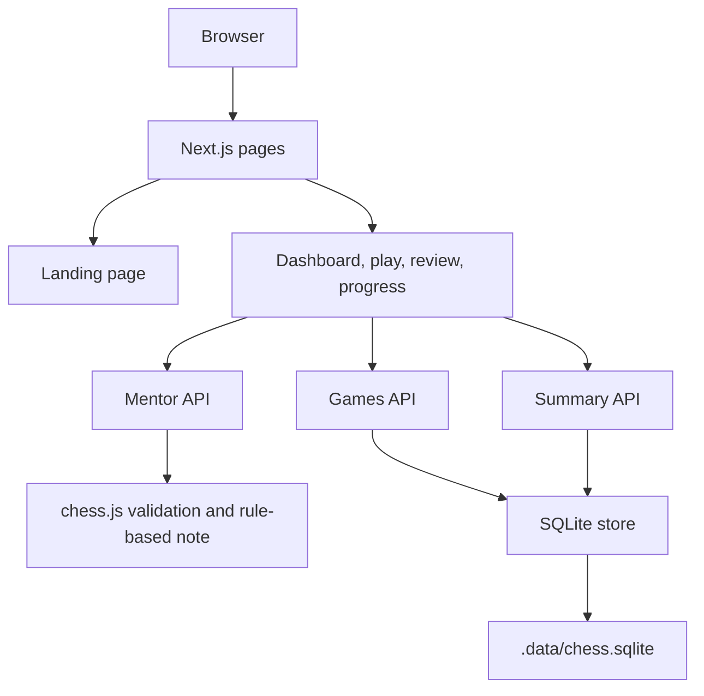

# Architecture

## System outline

## Page routes

| Route | Responsibility |
|---|---|
| `/` | Product landing page and interactive pawn board |
| `/app` | Learner dashboard |
| `/play` | Legal move exploration and mentor notes |
| `/review` | Sample game review and key moments |
| `/progress` | Skill and practice progress |

## API routes

- `GET /api/chess/summary` returns the learner overview and recent sessions.
- `POST /api/chess/mentor` validates a candidate move and returns a deterministic note.
- `GET /api/chess/games` lists stored sessions.
- `POST /api/chess/games` validates matching PGN/FEN data and saves the session.

The API handlers live in `app/api/chess/`; shared persistence is in `store.ts` beside those handlers. The local database is created under `.data/` and excluded from Git.

## Runtime boundary

The UI is rendered by Next.js. Interactive screens are client components; API handlers run on the server. The games endpoint selects the Node.js runtime because it uses `node:sqlite`. The SQLite file is local to the running instance, so this storage design is for local development and is not durable across serverless deployments.
